# ספר פרויקט — AirSnap

**צילום אווירי לפי דרישה**

מחבר: **אלון כתב** · סטארטאפ: **AirSnap**, נוסד על ידי סטודנטים מאוניברסיטת רייכמן.

---

> ## כל הזכויות שמורות
>
> הקוד, התיעוד והנכסים בפרויקט זה הם רכושם הבלעדי של **אלון כתב** ושל סטארטאפ **AirSnap**. אסור להעתיק, להפיץ או להשתמש בקוד, באופן מלא או חלקי, בלי רשות מפורשת בכתב. כל שימוש לא-מורשה ייחשב הפרת זכויות יוצרים על פי חוק זכות יוצרים, תשס״ח-2007.

---

## תוכן עניינים

- [מסמך אפיון](#מסמך-אפיון)
- [מסמך עיצוב](#מסמך-עיצוב)
- [מדריך למשתמש](#מדריך-למשתמש)
- [רפלקציה](#רפלקציה)
- [נספחים](#נספחים)

---

# מסמך אפיון

## 1. הקדמה

### 1.1 מטרת המסמך

המסמך מתאר את AirSnap ברמה גבוהה — למי הוא מיועד, מה הוא עושה ואילו טכנולוגיות הוא משלב. מי שמעוניין לצלול לאיך — ימשיך למסמך העיצוב.

### 1.2 שם המוצר

**AirSnap** הוא סטארטאפ של סטודנטים מאוניברסיטת רייכמן. המוצר: פלטפורמת צילום אווירי לפי דרישה. המשתמש פותח אפליקציה, רואה אם הוא בטווח של נקודת שיגור (״כוורת״), בוחר חבילה, משלם, וצופה ברחפן הסימולטיבי טס אליו ומצלם.

יתרון מול DJI/רחפנים פרטיים: אין צורך לקנות, ללמוד או לתחזק. תשלום-לפי-שימוש בלבד — ״Uber לצילום אווירי״.

### 1.3 מילון מושגים

| מושג | הסבר |
|---|---|
| Expo Go | אפליקציה להרצת אפליקציות React Native על מכשיר בלי build נטיבי. |
| React Native / Firebase / Firestore / Render / Socket.IO / Express | טכנולוגיות הליבה (פירוט במסמך העיצוב). |
| Hive (כוורת) | נקודת שיגור עם צי רחפנים. |
| Drone (רחפן) | יחידה אחת בתוך כוורת — סוללה, מיקום, מצב. |
| Order (הזמנה) | בקשת צילום בנקודה גיאוגרפית. |
| Credit (קרדיט) | מטבע פנימי (₪) לתשלום. |
| Referral / Promo code | הפניה / קוד קופון. |
| CAS | Compare-And-Set — מבטיח שהפניה מזכה פעם אחת בלבד. |
| ENU | East-North-Up — מערכת קואורדינטות מקומית של הסימולציה. |

---

## 2. תיאור כללי

### 2.1 תיאור המוצר

המערכת מורכבת משני חלקים:

1. **אפליקציית מובייל** (React Native + Expo) — UI, אימות, הזמנה, מעקב, גלריה.
2. **שרת סימולציה** (Node.js + Express + Socket.IO על Render) — אימות תוקני, ניהול כוורות, פיזיקת רחפנים, קרדיט (Firestore), קודי קופון, ושידור real-time.

זרימה אופיינית: המשתמש פותח את האפליקציה → רואה את המפה ואת הכוורת הקרובה → אם בטווח 500m → לוחץ ״Order Drone״ → בוחר חבילה → משלם → השרת מקצה רחפן, מתחיל סימולציה ב-30Hz, ומשדר אירועי `drone:state` ב-10Hz → הרחפן ״מגיע״ → המשתמש לוחץ ״Start Session״ → הרחפן מקיף ומצלם → התוכן מועבר לגלריה.

**פיצ׳רים נוספים**: קרדיט והפניה (₪5 בונוס הצטרפות, ₪20 בונוס למפנה), קודי קופון (balance/discount), ביטול הזמנה (דמי ביטול 10%), מסכי מנהל, וויזואליזציית web ב-`/` של השרת.

### 2.2 משתמשי היעד

- **לקוחות פרטיים** — אירועים אישיים, תיירות, ספונטניות.
- **עסקים מקומיים** — מסעדות עם נוף, מתחמים. נכנסים דרך טאב ״Partners״.
- **מנהלי המערכת** — צוות AirSnap. גישה ל-HiveAdminScreen, PromoCodeAdminScreen, וקרדיט ללא הגבלה.

### 2.3 דרישות מערכת

- **לקוח**: iPhone iOS 14+ או Android 8+, Expo Go, הרשאת מיקום, חיבור אינטרנט.
- **שרת**: Node.js 20, פרויקט Firebase עם Auth ו-Firestore, Service Account JSON, Render web service.

### 2.4 שירותים חיצוניים

- **Firebase Auth + Firestore** — אימות + persistence (תוכנית חינמית Spark).
- **Render** — אירוח השרת (free tier; נרדם אחרי 15 דק׳ ללא תעבורה).
- **Expo** — סביבת פיתוח והפצה.
- **Meshulam** — סליקה ישראלית (תכנון עתידי; כיום stop-gap).

---

## 3. דרישות מפורטות (Use Cases)

כל Use Case מציג: **תקציר**, **התחלה**, **מסלול עיקרי**, **מסלולים חלופיים**.

### 3.1 הרשמה למערכת
- **תקציר**: משתמש חדש נרשם עם שם, אימייל, סיסמה, וקוד הפניה אופציונלי.
- **מסלול**: SignUpScreen → validation מקומי (סיסמה ≥ 8 תווים, A-Z + a-z + 0-9) → `firebase.createUserWithEmailAndPassword` → `POST /users/me` → מסמך משתמש נוצר ב-Firestore עם קוד הפניה ייחודי + בונוס הרשמה אם בתקופה → ניווט ל-EmailVerificationScreen.
- **חלופי**: אימייל כבר רשום → 409 ידידותי. קוד הפניה לא קיים → מתעלם. self-referral → נחסם.

### 3.2 אימות אימייל
- **תקציר**: לחיצה על קישור מתיבת הדואר ולאחר מכן רענון באפליקציה. מנהלים עוקפים אוטומטית.

### 3.3 התחברות
- **תקציר**: אימייל/סיסמה או Google OAuth (דרך expo-auth-session).
- **מסלול**: `signInWithEmailAndPassword` → `onAuthStateChanged` → bootstrap `POST /users/me` → ניווט לפי מצב המשתמש.

### 3.4 הזמנת רחפן
- **תקציר**: בקשת סשן צילום בנקודה הנוכחית.
- **התחלה**: משתמש מאומת בתוך 500m מכוורת זמינה.
- **מסלול**: `POST /spatial/validate-geofence` → כפתור נדלק → PackageSelect → Payment → `POST /orders`. השרת תוקף, מקצה רחפן (`reserveDrone`), יוצר הזמנה, מתחיל סימולציה, מחזיר orderId, ומשדר `hive:updated`.
- **חלופי**: אין כוורות / מחוץ לטווח / כל הרחפנים בטעינה → 409 עם הודעה ידידותית.

### 3.5 בחירת חבילה
- **תקציר**: בחירה בין 3 חבילות (Quick Snap, Sky View, Epic Flight) מתוך `PACKAGES` קבועות.

### 3.6 תשלום
- **תקציר**: פיצול ידוע מראש בין קרדיט וכרטיס, עם קוד הנחה אופציונלי.
- **מסלול**: `splitPayment(total, credits, isAdmin)` בשרת. מנהל → חינם. אחרת — קרדיט מכסה ראשון, השאר לכרטיס. אם נשאר חיוב → `paymentStatus = 'awaiting_card'` ו-stop-gap מסך אישור. אחרת → `'paid'` ישירות.

### 3.7 מעקב אחר הטיסה
- **תקציר**: FlightTrackingScreen — מקבל אירועי `drone:state` ב-Socket.IO, מציג ETA, מרחק, סוללה, וטיימליין.

### 3.8 סשן לייב
- **תקציר**: ״Start Session״ → `session:start` → הרחפן עובר ל-RECORDING ומקיף את המשתמש. ״End Session Early״ → `session:end` → חזרה מוקדמת.

### 3.9 ביטול הזמנה (דמי ביטול 10%)
- **תקציר**: Back ב-FlightTracking לפני שהסשן התחיל → דיאלוג אישור → `POST /orders/:id/abandon` → 90% חוזר כקרדיט, 10% נשמר כדמי ביטול, הרחפן חוזר לכוורת.

### 3.10 צפייה בגלריה והיסטוריה
- **תקציר**: AsyncStorage cache מקומי + רענון מהשרת. Gallery (masonry, סינון), OrderHistory (רשימת כרטיסים עם 3 thumbnails כל אחד).

### 3.11 צפייה ביתרת קרדיט והפניה
- **תקציר**: CreditsScreen מציג balance, referral code (6 תווים), כפתור Share, redeem code, ו-ledger אחרון.

### 3.12 מימוש קוד קופון
- **תקציר**: balance code → CreditsScreen → היתרה עולה מיד. discount code → PaymentScreen → הנחה בהזמנה. הכל ב-`promoStore.redeemPromo` בתוך טרנזקציה.

### 3.13 מנהל — ניהול כוורות
- **תקציר**: HiveAdminScreen → לחיצה על מפה → `POST /hives`. השרת ממזג כוורות ברדיוס 25m אוטומטית. השרת משדר `hive:created/updated/deleted` בזמן אמת לכל המכשירים המחוברים.

### 3.14 מנהל — ניהול קודי קופון
- **תקציר**: PromoCodeAdminScreen מוגן ב-passcode ״Alon132״. כל endpoint דורש גם `requireAdmin` (מייל) וגם `X-Admin-Pass` (header). אסימון מנהל גנוב לבדו לא מספיק.

---

# מסמך עיצוב

## 1. הקדמה

מסמך זה מתאר איך המערכת בנויה: מודולים, מבני נתונים, API, וממשק המשתמש (UI).

### 1.1 מילון מושגים נוסף

| מושג | הסבר |
|---|---|
| `useState`/`useEffect`/`useRef` | React Hooks. |
| `useFocusEffect` | Hook של React Navigation — רץ בכל focus של המסך. |
| AsyncStorage | storage מקומי במובייל (key-value). |
| Firestore Transaction | טרנזקציה אטומית — קריאה, חישוב, כתיבה. נכשלת אם הנתונים השתנו בינתיים. |
| ID Token | JWT שלקוח Firebase מקבל; השרת מאמת ב-Admin SDK. |
| Snapshot | תצוגת state של אובייקט (גם של Firestore וגם של מופע Drone). |

---

## 2. ארכיטקטורת המערכת

### 2.1 סקירה

ארבעה רכיבים שמתקשרים:

```
┌──────────────────┐                 ┌─────────────────────────┐
│ Expo Go (Phone)  │ ── HTTP + WS ──►│ Express + Socket.IO     │
│  AuthContext     │                 │   - requireAuth/Admin    │
│  SimClient       │ ◄── Events ──── │   - hiveStore (memory)   │
│  Screens         │                 │   - droneSim (30Hz tick) │
└────────┬─────────┘                 │   - userStore (Firestore)│
         │ verifyIdToken              │   - promoStore           │
         ▼                            └────────────┬────────────┘
   ┌──────────┐                                   │
   │ Firebase │ ◄── verifyIdToken ─────────────── │
   │   Auth   │                                   ▼
   └──────────┘                          ┌───────────────┐
                                          │   Firestore   │
                                          │  users/{uid}  │
                                          │  ledger       │
                                          │  promo_codes  │
                                          └───────────────┘
                                                   ▲
                                                   │
                                          ┌────────────────┐
                                          │ Browser viewer │
                                          │ (Leaflet web)  │
                                          └────────────────┘
```

עיקרון מנחה: **Firestore לכל מה שמייצג כסף** (חייב לשרוד restart). **In-memory לכל מה שקצר-חיים** (כוורות פעילות, רחפנים בטיסה — 30 פעמים בשנייה, אין מקום ל-latency של DB).

### 2.2 ארכיטקטורת המובייל

```
src/
├── components/        # קומפוננטות משותפות
├── config/            # firebaseConfig, serverConfig
├── constants/         # PACKAGES, DRONE_STATUS
├── context/           # AuthContext, ThemeContext, LocationContext
├── hooks/             # useGeofence
├── navigation/        # AppNavigator (stack + tabs)
├── screens/           # 16 מסכים
├── services/          # SimClient (HTTP + Socket.IO)
├── theme/             # צבעים, ריווחים, טיפוגרפיה
└── utils/             # haversine + formatters
```

State גלובלי דרך Context API (לא Redux). תקשורת עם השרת רק דרך `SimClient`.

### 2.3 ארכיטקטורת השרת

```
airsnap-server/
├── index.js          # Express + Socket.IO + drone lifecycle
├── auth.js           # Firebase Admin init + middlewares
├── hiveStore.js      # in-memory hive fleet + tick טעינה
├── orderStore.js     # in-memory orders Map
├── droneSim.js       # Drone class — 30Hz physics
├── userStore.js      # Firestore users + ledger transactions
├── promoStore.js     # Firestore promo codes + redemptions
├── credits.js        # pure helpers (splitPayment, validate)
├── samples.js        # photo/video URLs
├── geofence.js       # haversine + ENU
├── public/           # web viz (Leaflet)
└── render.yaml       # blueprint
```

### 2.4 מצבי הרחפן ופיזיקה

```
PENDING ─(1s)─► EN_ROUTE ─(climb→fly)─► ARRIVED ─session:start─► RECORDING
                                            │                        │
                                       abandon                  (timer / end)
                                            │                        │
                                            ▼                        ▼
                                       RETURNING ────► PROCESSING ─► DELIVERED
```

קבועי פיזיקה:
- **30Hz tick**, broadcast ב-10Hz.
- **MAX_H_SPEED** 18 m/s, **MAX_V_SPEED** 5 m/s.
- **CRUISE_ALT** 50m, **RECORD_ALT** 12m, **ORBIT_RADIUS** 15m.
- **MIN_DEPLOY_BATTERY** 30%, **CHARGE_RATE_PER_SEC** 4% (מלא ב-25 שניות).

כל הקואורדינטות הפנימיות ב-ENU (מטרים מהכוורת). המרה חזרה ל-lat/lng רק בכל broadcast.

### 2.5 ויזואליזציית web

נמצאת ב-`airsnap-server/public/`. Leaflet + CartoDB Voyager Dark tiles. סמני SVG עם רוטורים מסתובבים, טבעות battery, ו-Right panel עם Fleet card + per-hive cards + Active orders.

---

## 3. עיצוב נתונים ופרוטוקולים

### 3.1 Firebase Authentication

- **Providers**: Email/Password, Google.
- **Persistence**: AsyncStorage דרך `getReactNativePersistence`.
- **ID Token**: `Authorization: Bearer <token>` בכל קריאה authed. השרת מאמת ב-`admin.auth().verifyIdToken(token)`.
- **Admin**: רשימת מיילים ב-env (`ADMIN_EMAILS`). `isAdmin` נגזר ב-server-side.

### 3.2 מבנה Firestore

**`users/{uid}`**
```
{ email, displayName, credits, referralCode, referredBy,
  hasMadeFirstOrder, signupBonusGranted, createdAt, updatedAt }
```

**`users/{uid}/ledger/{id}`** — append-only audit log
```
{ type, amount, balanceAfter, reason, orderId?, promoCode?, createdAt }
```
סוגים: `signup_bonus`, `referral_bonus`, `promo_redeem`, `order_spend`, `admin_adjust`.

**`promo_codes/{CODE}`**
```
{ code, type ('balance'/'discount'), amount, maxRedemptions,
  redemptionCount, oneTimePerUser, expiresAt, createdBy, active }
```

**`promo_codes/{CODE}/redemptions/{uid}`** — קיום המסמך = ״המשתמש הזה כבר ניצל״.

### 3.3 מבנה in-memory בשרת

- **`hiveStore.hives`** — Map של כוורות עם מערך drones (id, battery, status).
- **`orderStore.orders`** — Map<orderId, Order>.
- **`drones`** ב-`index.js` — Map<orderId, מופע Drone>.

### 3.4 רשימת endpoints

| Endpoint | Auth | תפקיד |
|---|---|---|
| `GET /health` | — | בדיקת חיים |
| `GET /hives` | — | רשימת כוורות |
| `POST /spatial/validate-geofence` | — | מרחק לכוורת |
| `POST /users/me` | requireAuth | bootstrap |
| `GET /users/me` | requireAuth | מצב המשתמש |
| `GET /users/me/ledger` | requireAuth | 20 רשומות אחרונות |
| `POST /promos/redeem` | requireAuth | פדיון קוד |
| `POST /orders` | requireAuth | יצירת הזמנה |
| `GET /orders` / `GET /orders/:id` | requireAuth | היסטוריה / יחיד |
| `POST /orders/:id/confirm-payment` | requireAuth | stop-gap |
| `POST /orders/:id/abandon` | requireAuth | ביטול עם 10% |
| `POST /hives` / `DELETE /hives/:id` | requireAdmin | ניהול כוורות |
| `POST/GET/DELETE /admin/promos[/:code]` | requireAdminPass | ניהול קופונים |
| `POST /payments/webhook` | (HMAC עתידי) | Meshulam |

### 3.5 אירועי Socket.IO

**Server → Client**: `drone:state`, `order:status`, `session:progress`, `order:delivered`, `order:paid`, `order:abandoned`, `hive:created/updated/deleted`, `hives:snapshot`, `user:location`.

**Client → Server**: `hello:viewer`, `order:join`, `user:location`, `session:start`, `session:end`.

### 3.6 אבטחה — 3 שכבות

1. **Firebase ID token** — `requireAuth` בכל endpoint רגיש. השרת לא סומך על שדות מהלקוח (uid/email/isAdmin) — הכל נגזר מה-token.
2. **Email admin gate** — `requireAdmin` בודק `ADMIN_EMAILS` env.
3. **Passcode כפול** — `requireAdminPass` דורש גם email gate וגם `X-Admin-Pass` header. אסימון גנוב לבדו לא מספיק.

עקרונות נוספים: כל קרדיט מעודכן בטרנזקציה של Firestore; CAS על `hasMadeFirstOrder` למניעת bonus כפול; atomic redemption של קוד; owner-only על orders; self-referral check; קודי הפניה אקראיים בני 6 תווים מאלפבית בלי 0/O/1/I (~1B צירופים).

### 3.7 splitPayment

```js
function splitPayment(totalNis, availableCredits, isAdmin) {
  if (isAdmin) return { creditsApplied: 0, cardCharge: 0, adminFree: true };
  const credits = Math.min(availableCredits, totalNis);
  return { creditsApplied: credits, cardCharge: totalNis - credits };
}
```

מנהל → חינם. אחרת — קרדיט מכסה ראשון. Pure function, נבדק בקלות.

### 3.8 מערכת קרדיט (transactions)

**signup bonus** — מתבצע ב-`getOrCreateUser` רק אם בתקופה (`isSignupBonusEligible`).

**referral bonus** — בתוך טרנזקציה:
1. קרא `users/{uid}`.
2. אם `hasMadeFirstOrder` already true → no-op (CAS).
3. אחרת → `hasMadeFirstOrder = true`, ואם יש `referredBy` → מזכה את המפנה ב-₪20.

**order refund** — `userStore.adminAdjust(uid, +0.9*total, "Refund (90%) — abandon")` עם ledger entry שמוצג ב-CreditsScreen כ-״Order refund״.

### 3.9 מחזור חיים של הזמנה

```
created (awaiting_card or paid)
   │
   ├─ awaiting_card → confirm-payment → paid → onPaymentSucceeded
   │                                              ├─ markFirstOrder
   │                                              └─ payReferrer
   │
   └─ paid (admin/full credit) → onPaymentSucceeded
                                         │
                                         ▼
                                   DELIVERED (media) ── OR ──
                                                              │
                                                              ▼
                                                         abandoned (refund 90%)
```

---

## 4. ממשק משתמש (UI)

לכל מסך — תמונה, תיאור והדגשות.

### 4.1 LoginScreen

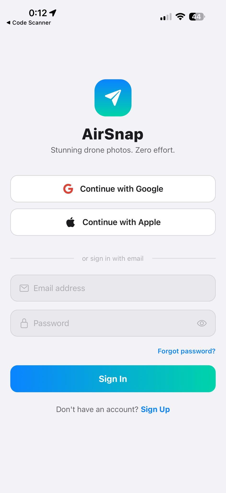

מסך כניסה ב-light mode. רכיבים:
- **לוגו AirSnap** — paper-plane בגרדיאנט + subtitle ״Stunning drone photos. Zero effort.״
- **כפתורי social** — Google, Apple (Apple מציג Alert חברתי ב-Expo Go).
- **טופס אימייל** — Email, Password (עם כפתור עין), קישור Forgot password, כפתור gradient ״Sign In״, קישור ל-Sign Up.

הקובץ: [src/screens/LoginScreen.js](src/screens/LoginScreen.js).

### 4.2 SignUpScreen

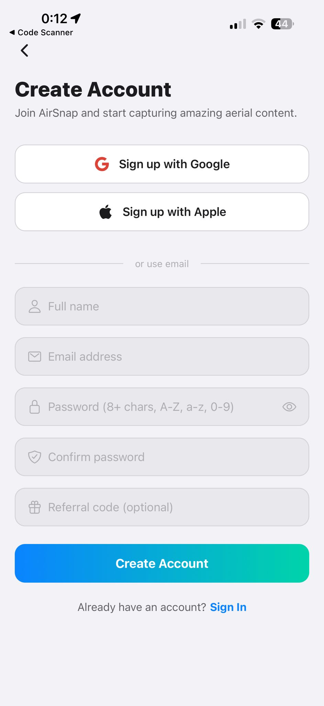

מסך ההרשמה. רכיבים:
- כפתור Back + ״Create Account״ + תת-כותרת.
- כפתורי Google/Apple.
- **5 שדות**: Full name, Email, Password (עם דרישות), Confirm password, **Referral code (optional)** עם אייקון מתנה.
- כפתור gradient ״Create Account״.

קוד ההפניה נשמר ב-`pendingReferralCodeRef` ומועבר ל-bootstrap מיד אחרי שה-Firebase מצליחה.

### 4.3 EmailVerificationScreen / 4.4 TermsAcceptanceScreen

> **[תמונות לא צורפו]**

מסכים פשוטים: EmailVerification עם כפתור Refresh + Resend; Terms עם checkbox + Accept.

### 4.5 HomeScreen

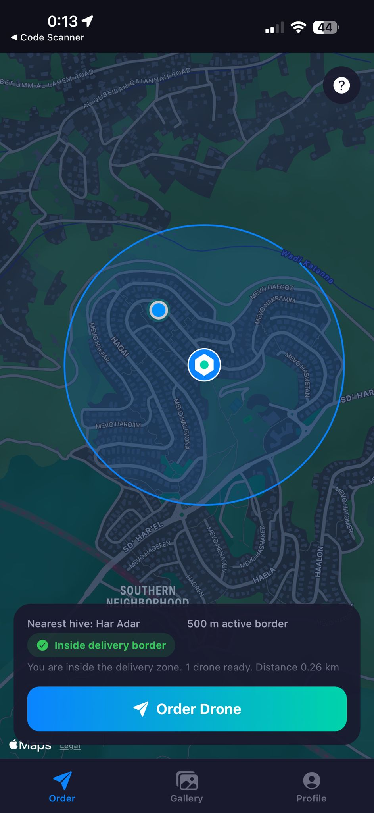

מסך הבית. בצילום, המשתמש בהר אדר עם כוורת ״Har Adar״ סמוכה. רכיבים:
- **מפה** Apple Maps + נקודת location כחולה native.
- **מעגל delivery zone** כחול חצי-שקוף ברדיוס 500m.
- **סמן כוורת** — משושה ירוק.
- **Bottom card**: ״Nearest hive: Har Adar | 500 m active border״, ״✓ Inside delivery border״, ״1 drone ready. Distance 0.26 km״, וכפתור gradient ״Order Drone״.

ה-state של הכוורות מנוהל דרך `simApi.listHives()` + subscriptions ל-`hive:created/updated/deleted` כך שהמסך מתעדכן בזמן אמת כשמנהל מוסיף או מוחק.

### 4.6 PackageSelectScreen

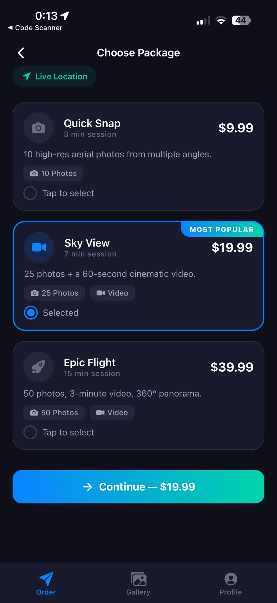

3 חבילות מ-`PACKAGES`:
- **Quick Snap** — $9.99 — 3 דק׳ — 10 תמונות.
- **Sky View** (נבחר, ״MOST POPULAR״) — $19.99 — 7 דק׳ — 25 תמונות + סרטון.
- **Epic Flight** — $39.99 — 15 דק׳ — 50 תמונות + סרטון + 360°.

כפתור gradient ״Continue — $19.99״ למטה.

### 4.7 PaymentScreen

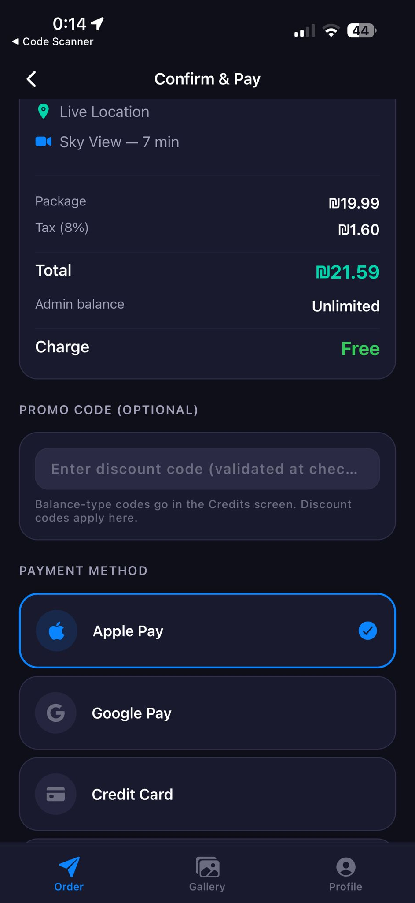

מצב **מנהל**: ״Admin balance: Unlimited״ → ״Charge: Free״. הוכחת הלוגיקה של `splitPayment(...isAdmin=true)`.

רכיבים:
- Order summary: Package ₪19.99 + Tax ₪1.60 = Total ₪21.59.
- שורות קרדיט: ״Admin balance: Unlimited״, ״Charge: Free״ (ירוק).
- **PROMO CODE (optional)** — שדה עם הסבר ״Balance-type codes go in the Credits screen. Discount codes apply here.״
- **PAYMENT METHOD** — Apple Pay (נבחר), Google Pay, Credit Card.

### 4.8 FlightTrackingScreen + דיאלוג ביטול

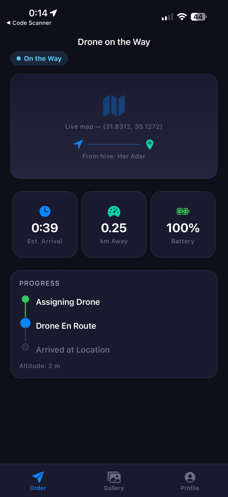

״On the Way״ — הרחפן בדרך. רכיבים:
- **StatusBadge** + Live map placeholder + ״From hive: Har Adar״.
- **3 כרטיסי סטטוס**: ⏰ 0:39 ETA, 📈 0.25 km, 🔋 100% Battery.
- **PROGRESS timeline**: Assigning Drone ✅, Drone En Route 🔵 (פולסי), Arrived at Location ⚪.
- ״Altitude: 2 m״.

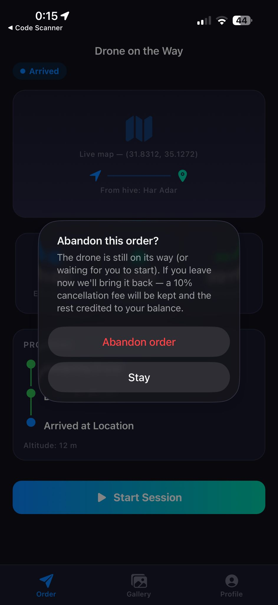

הדיאלוג שמופיע בלחיצת Back כשהרחפן עוד לא במצב הקלטה. ב-StatusBadge רואים ״Arrived״ — הרחפן הגיע וממתין.

הלוגיקה: `navigation.addListener('beforeRemove', ...)` תופס את הניסיון, מציג את ה-Alert (״10% fee will be kept and the rest credited״), ורק אחרי אישור → `POST /orders/:id/abandon`. השרת מחזיר 90% כקרדיט.

### 4.9 LiveSessionScreen

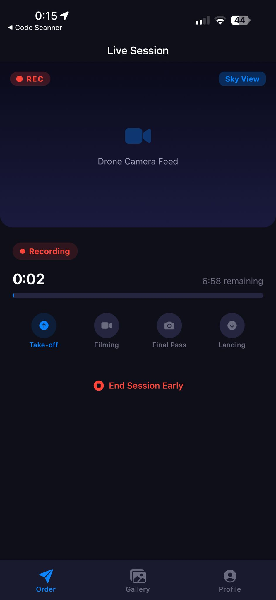

מסך הסשן. ה-`session:start` נשלח אוטומטית בעת ה-mount.

רכיבים:
- **REC badge** אדום פולסי (Animated.loop של 600ms).
- **Sky View pill** ימני-עליון.
- **Drone Camera Feed placeholder** (gradient כהה).
- **״Recording״ status badge**.
- **טיימר** 0:02 / 6:58 remaining + ProgressBar.
- **4 שלבים**: Take-off (פעיל), Filming, Final Pass, Landing.
- **End Session Early** באדום — שולח `session:end`.

### 4.10 ContentDeliveryScreen

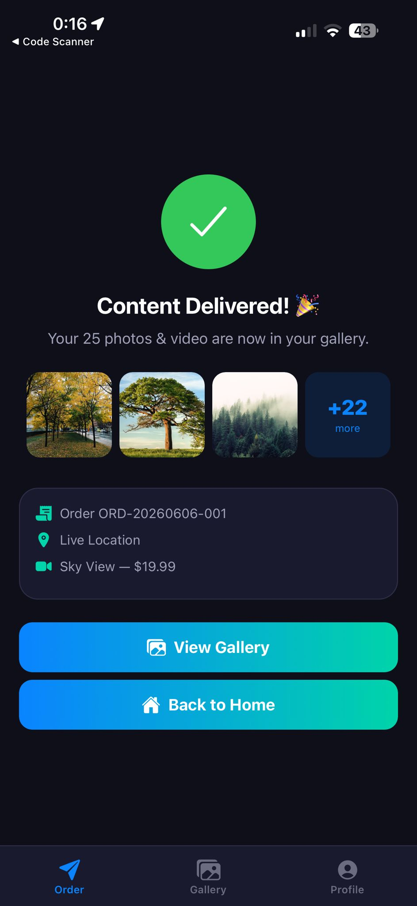

מצב Delivered:
- **וי ירוק** במעגל (אנימציית Spring).
- כותרת ״Content Delivered! 🎉״ + ״Your 25 photos & video are now in your gallery.״
- **3 thumbnails + ״+22 more״** (25 − 3).
- **Summary card**: Order ID, Live Location, Sky View — $19.99.
- **2 כפתורי gradient**: View Gallery, Back to Home.

`persistDelivery` שומר ל-`@airsnap_orders` ו-`@airsnap_gallery` ב-AsyncStorage כך שהמסכים האחרים יראו את התוכן מיד.

### 4.11 GalleryScreen

> **[תמונה לא צורפה]**

Masonry של 2 עמודות, chip-ים: All / Photos / Videos. לחיצה פותחת modal full-screen.

### 4.12 OrderHistoryScreen

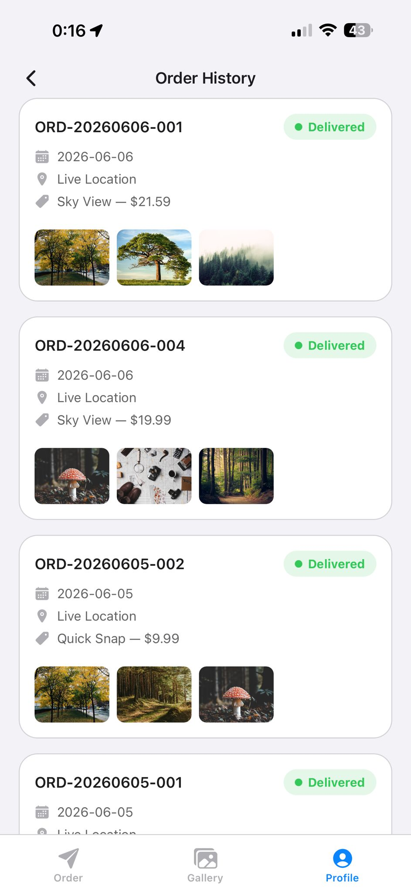

4 הזמנות מ-5-6 ביוני 2026 (כולן Delivered). כל כרטיס: Order ID + StatusBadge ירוק + תאריך + Live Location + חבילה ומחיר + 3 thumbnails.

הטעינה: AsyncStorage cache → `GET /orders` → מיזוג ב-Map לפי `order.id`.

### 4.13 ProfileScreen — 3 וריאציות

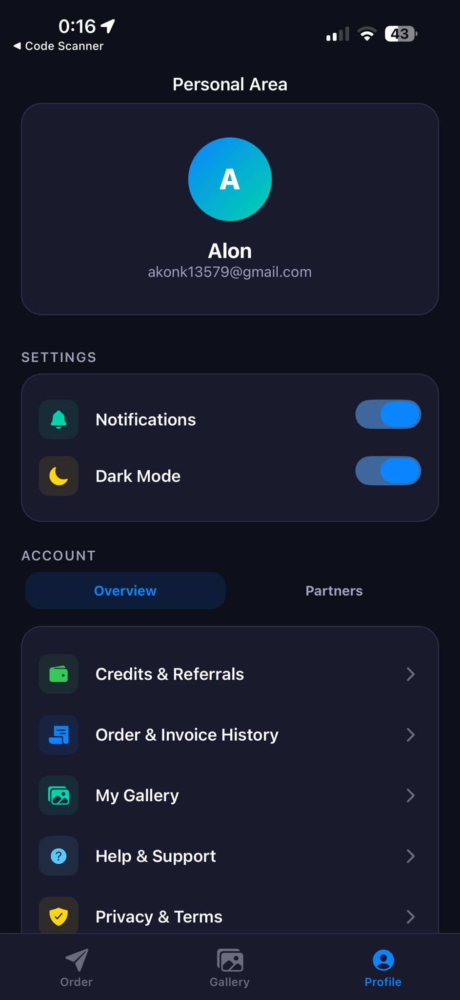

טאב Overview ב-dark mode. כרטיס פרופיל (avatar gradient ״A״, ״Alon״, מייל), SETTINGS (Notifications, Dark Mode toggles), tabs Overview/Partners, ותפריט: Credits & Referrals, Order History, My Gallery, Help & Support, Privacy & Terms. אדמין רואה גם Manage Hives ו-Promo Codes.

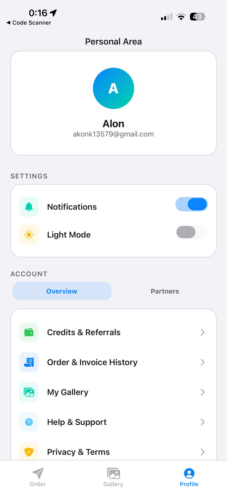

אותו תוכן ב-light. ה-toggle הופך ל-״Light Mode״ עם אייקון sun. החלפה דרך `ThemeContext.toggleTheme()`.

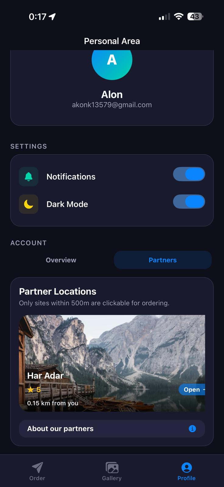

טאב Partners — כרטיס שותף ״Har Adar״ עם תמונת רקע, דירוג ★5, מרחק (0.15 km), וכפתור Open. לחיצה בודקת geofence; אם בטווח → מנווט להזמנה עם פרטי האתר.

### 4.14 CreditsScreen

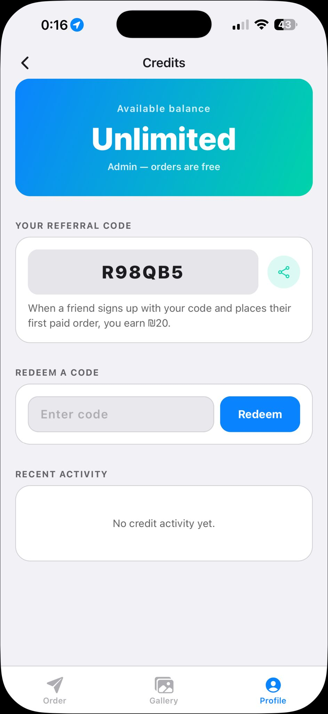

light mode, חשבון מנהל. רכיבים:
- **Balance hero**: gradient ״Available balance / Unlimited / Admin — orders are free״.
- **YOUR REFERRAL CODE**: ״R98QB5״ + כפתור Share (`Share.share()` של RN).
- **REDEEM A CODE**: שדה + כפתור Redeem.
- **RECENT ACTIVITY**: ״No credit activity yet״ — במצב רגיל יוצגו עד 10 רשומות עם אייקון לפי סוג.

### 4.15 HiveAdminScreen

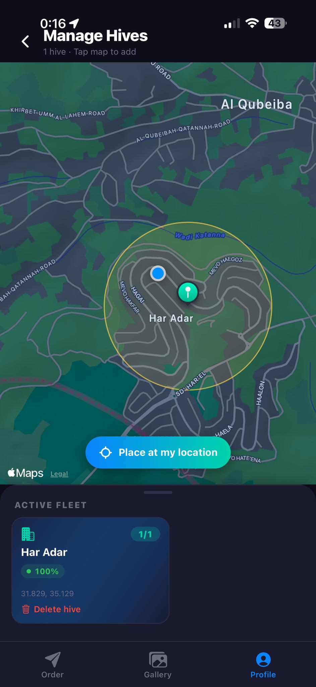

ניהול כוורות (אדמין). רכיבים:
- Header ״Manage Hives | 1 hive · Tap map to add״.
- מפה Apple Maps עם כוורת Har Adar (pin ירוק) ומעגל delivery zone צהוב.
- כפתור gradient ״Place at my location״.
- **ACTIVE FLEET card**: Har Adar | 100% | 1/1 | קואורדינטות | כפתור Delete hive.

לחיצה במפה פותחת modal הוספה. השרת ממזג כוורות ברדיוס 25m אוטומטית ומשדר אירוע מתאים.

### 4.16 PromoCodeAdminScreen

> **[3 תמונות לא צורפו]**

3 תצוגות: passcode prompt (BlurView + שדה passcode + כפתור Unlock), רשימת קודים פעילים/לא פעילים, ו-modal יצירה (Code, type pills, Amount, Max redemptions, Expires, One per user).

### 4.17 ויזואליזציית web

> **[תמונה לא צורפה]**

`https://airsnap-faeg.onrender.com/`. מפה Leaflet כהה (CartoDB Voyager Dark), סמני SVG עם רוטורים מסתובבים, טבעות battery סביב הכוורות, ו-Right panel: Fleet card + per-hive cards + Active orders. מתחבר ל-Socket.IO עם `hello:viewer` (read-only).

---

# מדריך למשתמש

## 5.1 התקנה

1. התקן Expo Go מ-App Store / Play Store.
2. סרוק את ה-QR Code שתקבל ממנהל הפרויקט.
3. האפליקציה תיטען (~30 שניות).

## 5.2 הרשמה

1. במסך ההתחברות → ״Sign Up״.
2. מלא: שם, אימייל, סיסמה (8+ תווים עם A-Z, a-z, 0-9), אימות.
3. אופציונלי: הזן **קוד הפניה** מחבר — שניכם תרוויחו.
4. אשר את האימייל מתיבת הדואר → חזור לאפליקציה → ״I've verified״.

תקבל **₪5 בונוס הצטרפות** (בתקופת המבצע).

## 5.3 הזמנת רחפן

1. ודא שאתה בטווח של כוורת (סמן ירוק במפה).
2. ״Order Drone״ → בחר חבילה → לחץ ״Continue״.
3. במסך התשלום: בדוק את החלוקה (Credits applied / Card charge).
4. אם יש לך קוד הנחה — הזן אותו ב-״Enter discount code״.
5. ״Place Order״ → בהתראת ״Confirm payment״ → Pay.
6. תועבר למסך מעקב. כשהרחפן יגיע — לחץ ״Start Session״.
7. הסשן יסתיים אוטומטית, או לחץ ״End Session Early״.

## 5.4 ביטול הזמנה

לחיצה Back במעקב לפני שהסשן התחיל → ״Abandon order״ → הרחפן חוזר, 90% מהסכום חוזר כקרדיט, 10% נשמר כדמי ביטול.

## 5.5 קרדיט וקופונים

- Profile → ״Credits & Referrals״.
- היתרה יורדת בתשלום, עולה ב: בונוס הצטרפות, בונוס הפניה, קוד balance, refund על ביטול.
- שתף את הקוד שלך בכפתור Share. כשחבר נרשם עם הקוד ומבצע הזמנה ראשונה — אתה מקבל ₪20.
- **קוד balance** → CreditsScreen → Redeem.
- **קוד discount** → PaymentScreen בעת הזמנה.

## 5.6 פעולות מנהל

- **כוורות**: Profile → ״Manage Hives״ → לחץ במפה. מיזוג ברדיוס 25m אוטומטי.
- **קופונים**: Profile → ״Promo Codes״ → סיסמה ״Alon132״ → New → מלא פרטים → Create.

## 5.7 פתרון בעיות נפוצות

- ״Out of delivery range״ → התקרב לכוורת.
- ״All drones are recharging״ → חכה לטעינה.
- ״Could not place order״ → השרת free-tier נרדם, נסה שוב אחרי 20 שניות.
- ״Wrong passcode״ במסך קופונים → ודא ״Alon132״ עם A גדולה.

---

# רפלקציה

## מה למדתי

הפרויקט היה הזדמנות לבנות מערכת end-to-end אמיתית — לא CRUD אלא מערכת עם רחפן סימולטיבי, פיזיקה, payments, real-time, ועיצוב UX.

טכנולוגיות חדשות שלמדתי: **React Native + Expo**, **Firebase Auth + Firestore + Admin SDK**, **Socket.IO**, **Express middleware patterns**, **פיזיקת quadcopter בסיסית** (ENU frame, integration tick, yaw rates), והעבודה על **Render free tier** עם המגבלות שלו.

## אתגרים מרכזיים

1. **Render free tier sleeping** — השרת נרדם אחרי 15 דק׳ ללא תעבורה. הקריאה הראשונה לוקחת ~20 שניות. הפתרון: AsyncStorage cache במובייל לכל מה שעבד אופליין (Gallery, Order History).

2. **Race condition בבונוס הפניה** — שתי הזמנות מקבילות יכלו לזכות את החבר פעמיים. הפתרון: **CAS על `hasMadeFirstOrder`** בתוך טרנזקציה של Firestore. רק העברה הראשונה ש״תופסת״ את הדגל מזכה.

3. **באג ״הרחפן תקוע״** — לחיצת Back במסך מעקב השאירה את הרחפן מרחף לנצח, וחסמה את הכוורת. הפתרון הוא דו-צדדי: ב-mobile `beforeRemove` listener עם דיאלוג; בשרת `POST /orders/:id/abandon` עם החזר 90% והעברת הרחפן הביתה.

4. **מהיר vs אמין** — לולאת ה-30Hz של הרחפן לא יכולה לסבול latency של Firestore. הפתרון: state פיזיקלי בזיכרון, state כספי ב-Firestore.

5. **Expo Go limits** — Firebase native לא נתמך ב-Expo Go. עברתי ל-Web SDK עם `getReactNativePersistence(AsyncStorage)`. מאפשר לכל בעלי הטלפונים להריץ ישירות, בלי build.

## דברים שהייתי עושה שונה

- **בדיקות אוטומטיות מההתחלה** — כל refactor הצריך לבדוק את כל הפלואו ידנית. Jest על `credits.js`/`promoStore.js`/`userStore.js` היה חוסך שעות.
- **לחבר Meshulam מוקדם** — ה-stop-gap עבד אבל הוסיף עומס מנטלי.
- **State machines מתועדים ויזואלית** — צייר אותם מהיום הראשון, לא רק עכשיו.

## לקחים

- ״הקטע הקל הוא המסלול הראשי; הקטע הקשה הוא ה-edges״. הזרימה המרכזית הייתה מהירה לבנות. הזמן הוצא על באגים בצדדים (drone stays, hive doesn't update, referral fires twice).
- **״כסף דורש טרנזקציות״**. אין חצי דרך עם מטבע וירטואלי.
- **״תיעוד שווה זמן״**. README/SETUP/PROJECT_BOOK חוסכים שעות של ״איך זה עובד שוב״.

---

# נספחים

## נספח א' — הצהרת זכויות יוצרים

**כל הזכויות שמורות.** הקוד, התיעוד והנכסים בפרויקט הם רכושם הבלעדי של **אלון כתב** ושל סטארטאפ **AirSnap** (אוניברסיטת רייכמן). אסור להעתיק, להפיץ, לשנות או להשתמש בקוד ללא רשות בכתב. שימוש לא-מורשה ייחשב הפרת זכויות יוצרים (חוק זכות יוצרים, תשס״ח-2007).

הפרויקט כולל מימושים מקוריים: מנגנון קרדיט והפניה עם ledger אטומי, מערכת קודי קופון עם passcode כפול, סימולציית פיזיקת רחפנים, ויזואליזציה real-time, ומערכת geofence עם מיזוג כוורות.

## נספח ב' — קישורים

- **Render deployment**: `https://airsnap-faeg.onrender.com`
- **Firebase Console**: https://console.firebase.google.com/project/airsnap-7844f
- **Reichman University**: https://www.runi.ac.il
- **Expo**: https://docs.expo.dev
- **React Navigation**: https://reactnavigation.org
- **Socket.IO**: https://socket.io/docs/v4/

## נספח ג' — מסכים וקבצים מרכזיים

**מסכי האפליקציה (`src/screens/`)**: LoginScreen, SignUpScreen, ForgotPasswordScreen, EmailVerificationScreen, TermsAcceptanceScreen, HomeScreen, PackageSelectScreen, PaymentScreen, FlightTrackingScreen, LiveSessionScreen, ContentDeliveryScreen, GalleryScreen, OrderHistoryScreen, ProfileScreen, CreditsScreen, HiveAdminScreen, PromoCodeAdminScreen.

**קבצי השרת (`airsnap-server/`)**: `index.js` (routes + lifecycle), `auth.js` (middlewares), `hiveStore.js`, `orderStore.js`, `droneSim.js`, `userStore.js`, `promoStore.js`, `credits.js`, `samples.js`, `geofence.js`, `public/index.html` + `public/sim.js` (web viz), `render.yaml`.

**מודולי תשתית במובייל**: `src/context/AuthContext.js`, `ThemeContext.js`, `LocationContext.js`, `src/services/SimClient.js`, `src/navigation/AppNavigator.js`, `src/hooks/useGeofence.js`, `src/config/firebaseConfig.js`, `src/config/serverConfig.js`.

---

**סוף הספר** · נכתב 2026-06.
